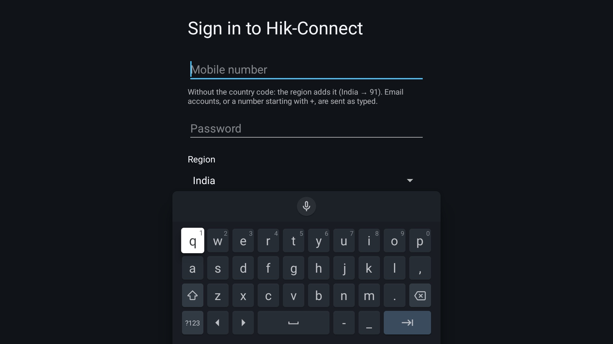
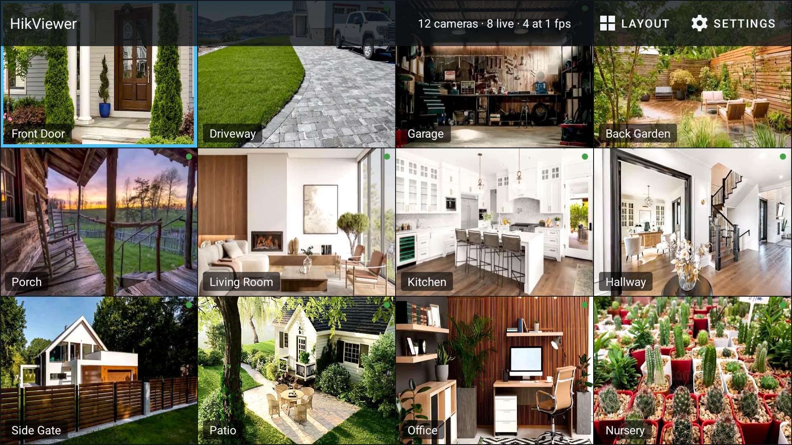
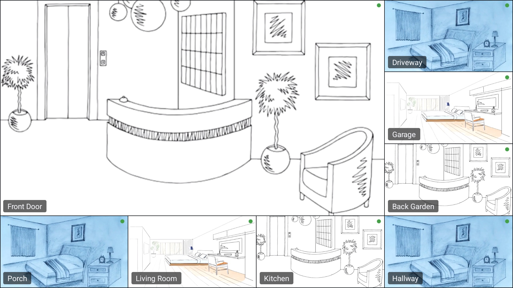
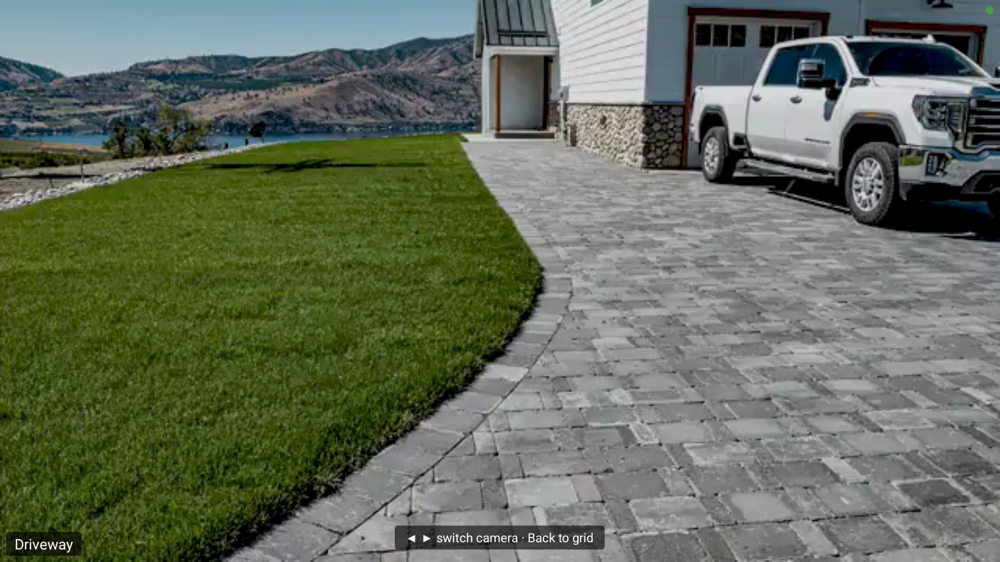
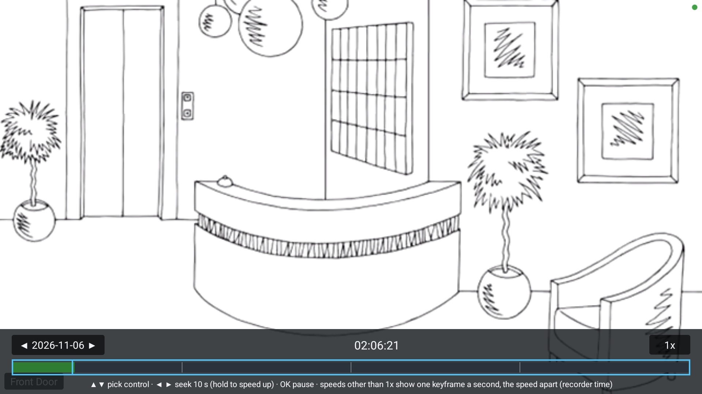
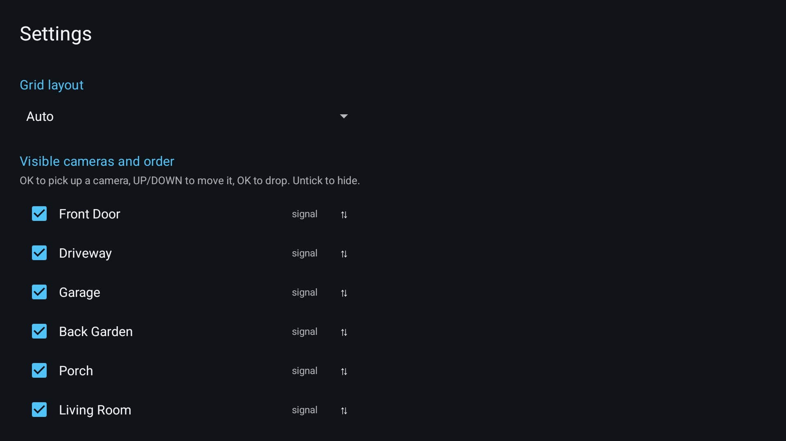
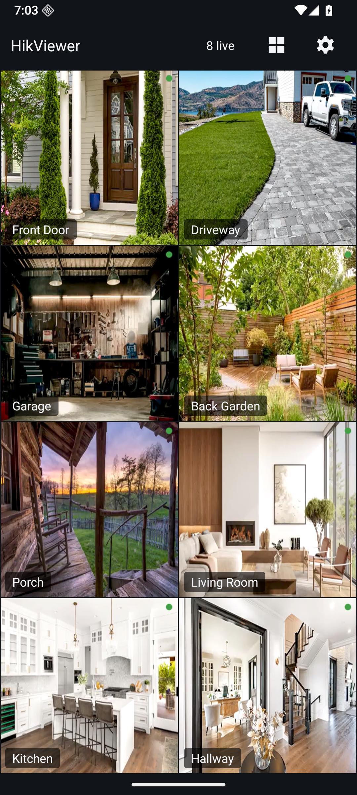
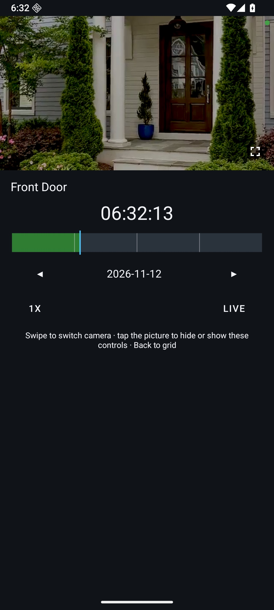

# HikViewer

     

**HikViewer** is a small, open-source Android TV and phone client for **Hik-Connect** accounts. Sign in, pick the channels of your Hikvision DVR or NVR, and watch them live in a grid built for a remote control, a mouse or a finger. Encrypted cloud streams are decrypted on the device with your own video verification code. No alarms, no notifications, no accounts of its own, and a 2 MB APK instead of the 270 MB official app.

## Screenshots

The footage in these screenshots is synthetic: the debug build has a demo mode that plays bundled clips made from stock pictures of empty rooms, one per placeholder camera name, so no real camera ever appears in the repository. See [BUILDING.md](BUILDING.md#demo-mode-and-screenshots).

| Sign in | 4 × 3 grid with the top bar | 1 + 7 (hero) layout |
| :---: | :---: | :---: |
|  |  |  |

| Fullscreen | Recorded playback | Settings |
| :---: | :---: | :---: |
|  |  |  |

| Phone grid (portrait) | Phone camera: live on top, timeline below |
| :---: | :---: |
|  |  |

## Features

- **Hik-Connect sign-in** with the official app's protocol. Sessions refresh themselves.
- **Channel list**: Channels with a video signal are shown by default, Settings lets you choose which cameras appear and in which order.
- **Grid layouts**: Auto, 3 × 3, 4 × 3, 4 × 4 and the "1 + N" family (1 + 5, 1 + 7, 1 + 9, 1 + 11, 1 + 15: one large hero tile with N small ones to its right and below). Auto picks the smallest shape that holds every camera. Phone remembers one layout per orientation, so you can have 2 × 7 upright and 4 × 3 sideways. Tile positions are remembered per layout and the last layout of each orientation is restored on launch.
- **Tile menu**: long-press a tile for *Move*, *Change* and *Playback*. **Move** for rearranging camera in grid, **Change** to pick any of your cameras from a list and **Playback** to chek past camera recording.
- **Live dot**: a small dot in each tile's top-right corner is green while pictures reach the screen at the stream's rate, a lighter green while the tile shows one still a second, and red while the tile is connecting, stalled or failed.
- **Tile overlays** (*Settings → Tile overlays*): *Show camera names* is off by default because the recorder burns the name into the picture; a tile that has lost its stream shows its name anyway, over the retry icon, so you know which camera failed, and hides it again once video is back. With names on, *Camera name position* puts the label top left, bottom left (the default) or bottom right of every tile, in fullscreen too; the top right stays free for the live dot and the optional *Show frame rate* counter. Both choices are in a backup.
- **Encrypted streams**: the first time a stream needs the key you are asked for the recorder's video verification code. It is checked locally against the recorder's `MD5(MD5(code))` before any stream is opened, stored in Android-encrypted preferences, and never asked again unless the recorder's code changes.
- **Built for weak TVs**: a hardware decoder for the hero tile and for fullscreen (moving the focus never touches a decoder), software decoders for the other live tiles, and a shared keyframe-only decoder pool for tiles beyond what the device can decode live. The live budget adapts to RAM, cores and measured decode lag. A decoder that stops producing pictures is caught within about 1.5 s and rebuilt without costing the tile its live slot. A failed tile dims behind a single outlined refresh icon.
- **Clean lifecycle**: every stream, socket and decoder is released in `onStop`. There are no services, jobs or alarms, so the app costs nothing when it is not on screen.

## How it works

1. **Sign in** against `api.hik-connect.com` (`/v3/users/login/v2`), following the regional redirect the cloud answers with; the password travels as an MD5 hash like in the official app.
2. **List devices and channels** (`/v3/userdevices/v1/devices/pagelist`, `cameras/info`); the device record also says whether streams are encrypted and carries the hash the verification code is checked against.
3. **Open a stream**: fetch the VTM relay assignment for the channel, sign a VTDU token with the session, and connect over plain TCP to the relay (`ysproto://` framing). Live streams come as RTP or MPEG-PS; recordings as MPEG-PS from `/v3/streaming/records` spans.
4. **Decrypt on the device**: each H.264/H.265 NAL body is AES-ECB encrypted with your verification code as the key; the three key variants seen in the wild are detected from the parameter sets, and which NAL types a recorder leaves in the clear is learnt from the stream (this DVR encrypts only keyframes, parameter sets and long-term-reference P-frames). The H.264 SPS is rewritten to declare no frame reordering, so software decoders show each picture as soon as it is decoded.
5. **Decode with `MediaCodec`**, feeding access units straight to the codec. At most two hardware decoders are used (the hero tile; the fullscreen screen takes one); the rest are software, or keyframe-only stills from a shared pool when the device runs out of CPU.

All protocol code lives in the pure-JVM `:core` module and is covered by known-answer tests against synthetic ffmpeg-generated fixtures (`scripts/gen-fixtures.sh`); `:app` is the Android UI and decoder plumbing.

## Install

Download `HikViewer-<version>.apk` from the [Releases](https://github.com/itsluminous/HikViewer/releases) page. It is one APK for every CPU.

- **Android TV**: sideload it. Either `adb connect <tv-ip>` then `adb install -r HikViewer-<version>.apk`, or copy the APK to a USB stick and open it with a file manager on the TV. HikViewer appears on the TV home screen with its own banner.
- **Phone or tablet**: open the APK from your downloads (allow installs from that source once), or `adb install -r` it. The same APK handles touch, portrait and landscape.
- Android 8.0 (API 26) or newer. Verify a download with the `SHA256SUMS` file attached to the release, or with `apksigner verify --print-certs <apk>`.

## Usage tips

- **Many live tiles on a small TV**: the DVR decides the sub-stream's resolution and frame rate, not the app. For 12 or more live tiles set the sub-stream to **640 × 360 at 6–8 fps** on the recorder (*Record → Parameters → Sub-stream*); software decoding costs about a fifth of a core per 960 × 480 @ 12 fps tile, so halving the pixels and the frame rate is what lets a 1 GB TV keep every tile live instead of falling back to keyframe stills.
- **How many tiles are live**: the app decides, there is no setting. Every live tile costs a software decoder (about a fifth of a core at 960 × 480 @ 12 fps), so the live count stops at what the device was measured to sustain at 12 fps (8 on a 1.8 GB 4-core TV, 4 on a 1 GB set) and quietly tries a few more only when it measures idle CPU and spare memory, handing them back when either runs out. The first N tiles in grid order (the hero first) are live and the rest show one picture a second; sustained decode lag drops tiles below the ceiling one at a time and they come back after a calm spell. Lowering the recorder's sub-stream frame rate is the lever that raises the number of live tiles, because half the frame rate is half the decoding work.
- **The first minutes on a slow TV**: right after launch a weak TV can be busy enough that the app temporarily shows one or two tiles as 1 fps stills (their dot stays green while stills arrive); they return to live video within a couple of minutes once the device settles. Fewer visible cameras or a lower sub-stream frame rate on the recorder removes the dip.
- **Reading the dots and the status**: a green dot means pictures are arriving on that tile, at stream rate or as one still a second; the top bar says how many of each ("8 live · 6 at 1 fps"). A red dot is a tile that is connecting or has lost its stream; one that stays red dims and shows the refresh icon, and OK on it reopens that stream. Grid tiles run about half a second behind the hero and fullscreen: that is the jitter buffer that keeps their motion even.
- **A tile that says "Decoder error"**: the hardware decoder is a preference, not a requirement. A tile whose hardware decoder fails (whatever the error code the TV's codec reports) falls back to a software decoder on its own, and hardware is tried again later; only a tile whose software decoder fails too stays on "Decoder error". Long-press that tile (hold OK, long click or long touch; or long-press its refresh icon) to open "Decoder detail", a small dialog with the codec name, the error code and the codec's diagnostic text to photograph or copy into a bug report; OK closes it, and OK on the tile retries. The app also reads how many hardware decoders the TV's codec allows (`hardware slots=N (codec max=M)` at startup in logcat) and asks for the low-latency mode only from a decoder that declares it.
- **Region sets the country code**: pick your region on the sign-in screen and type the mobile number without the country code (India → 91 is added for you). Type a leading `+` to send exactly what you typed, or your e-mail address if the account uses one.
- **Hero camera**: in a 1 + N layout long-press a tile → *Move* and push it to the top-left, or long-press the hero tile → *Change* and pick the camera that should be there.
- **Backup and restore**: *Settings → Backup* writes `HikViewer-backup-YYYYMMDD-HHMM.json` with the visible cameras and their order, each layout's tile positions (the hero is position 0), the last layout of each orientation, fullscreen quality, the overlay toggles with the camera name position, and keep-screen-on. The session, the account and the encryption password are not in it, so a restored device still has to be logged in and may ask for the verification code once. The file is versioned (`"format": 1`); a file of another format, another app, with a layout name this version does not know, or larger than 1 MiB is refused and nothing changes, while unknown fields and unknown camera keys are kept. No storage permission is involved: on a phone the documents picker asks where to save or which file to open; on a TV, which has no picker, Backup writes to `/sdcard/Download/` (the confirmation shows the exact path, `adb pull` it from there) and Restore lists the backups it finds, newest first. To bring a file onto a TV, `adb push HikViewer-backup-x.json /sdcard/Android/data/com.itsluminous.hikviewer/files/` and open Restore: the empty-state message names that folder, because since Android 10 an app without a storage permission cannot read a file in `Download` that another app or `adb` put there (MediaStore hides the row and the file system refuses to open it, verified on an API 34 TV emulator). The grid applies a restore when you go back to it.
- **Recorder time**: the time bar, the date and the playhead are in the recorder's own clock, the one burnt into the picture, whatever zone your phone or TV is in. The app learns how far that clock is from the device's from the newest recording (rounded to a quarter hour, remembered per recorder, refreshed on every listing), so the live playhead sits at the recorder's current time and *Playback* opens on its newest footage even when the recorder is already on the next date. The time label always shows the recorder's time, for example `20:13:05`; when the two clocks differ a smaller second line gives your own, such as `Local time  06:43 PT (+13:30)` (the device time of the playhead, your zone's short name and how far ahead the recorder is), and when they agree that line is absent. A recorder whose channel stopped recording before its current day began may be misread on the first open until a channel that does record is opened.
- **Fullscreen quality**: *Settings → Fullscreen quality* can select the main stream (often HEVC 720p+); that needs a hardware decoder, so leave it on *Sub* if fullscreen stutters.
- Memory: on a 1080p Android TV the app sits around 100 MB PSS with 12 live tiles and drops to a cached process holding no decoders or sockets within seconds of HOME or Back.

## Building

See [BUILDING.md](BUILDING.md) for prerequisites, build, tests, lint and coverage, the emulators, the demo mode used for the screenshots, the real-account integration test and release signing.

## Contributing

Issues and pull requests are welcome. Keep `./gradlew check` green (ktlint, detekt, Android Lint with warnings as errors, unit tests with coverage floors), add a test with every behaviour change, and never commit real credentials, serials or camera footage: `local.env`, `.screenshots/` and `.research/` are gitignored for that reason. Commit messages follow Conventional Commits.

## References

HikViewer stands on the shoulders of the open-source projects that documented the Hik-Connect / EZVIZ protocols before it. They are credited, with what each one taught us, in [REFERENCES.md](REFERENCES.md). Release notes are generated by GitHub from the commits of each release; known gaps and ideas live in [docs/FOLLOW-UPS.md](docs/FOLLOW-UPS.md).

## Disclaimer

HikViewer is an unofficial client. It is not affiliated with, endorsed by or supported by Hikvision, EZVIZ or Hik-Connect. It speaks a private, undocumented protocol that may change or be restricted at any time, and it only works with cameras you own and an account you control. Use it at your own risk.

## License

[MIT](LICENSE) © 2026 itsluminous
