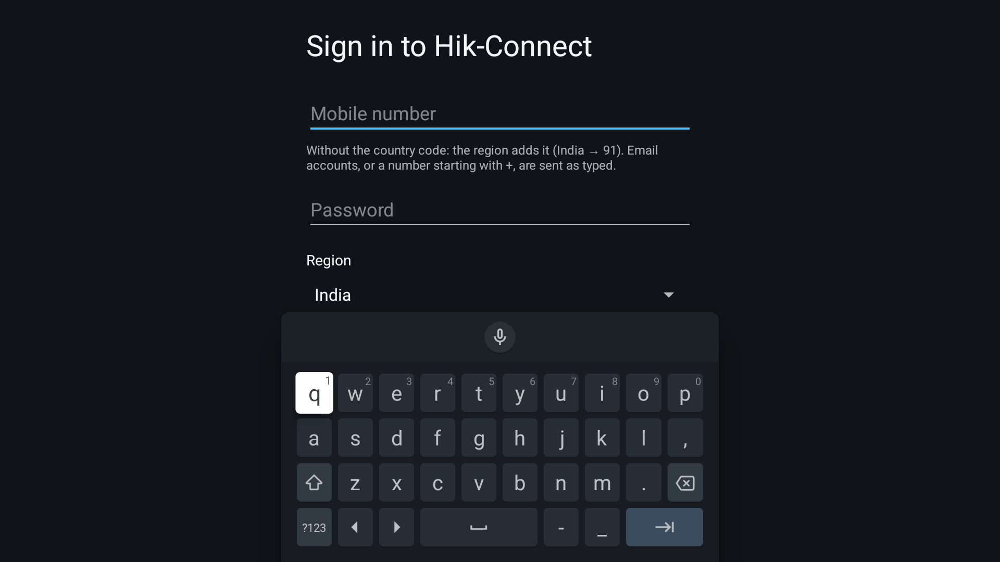
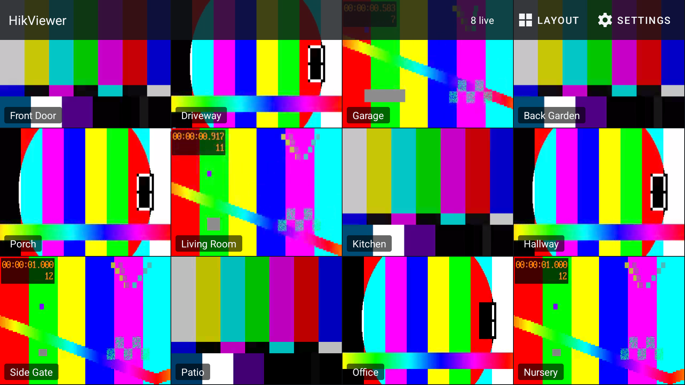
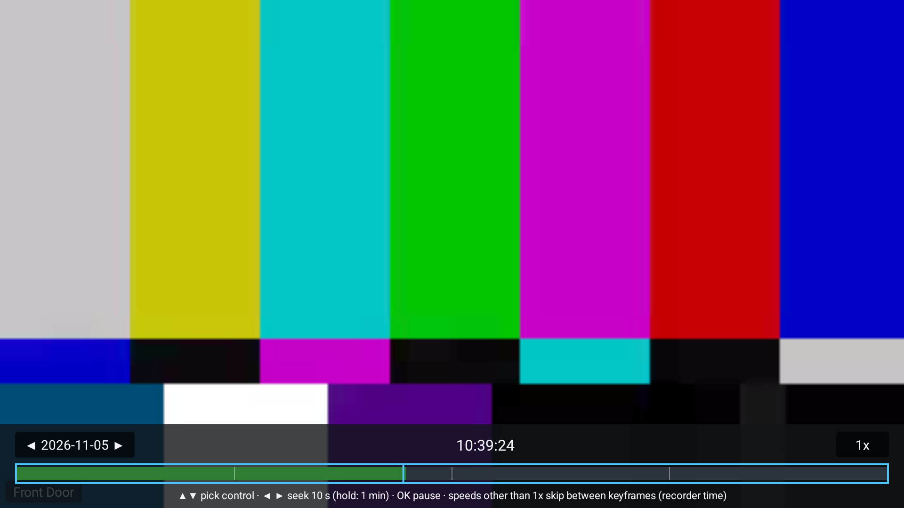
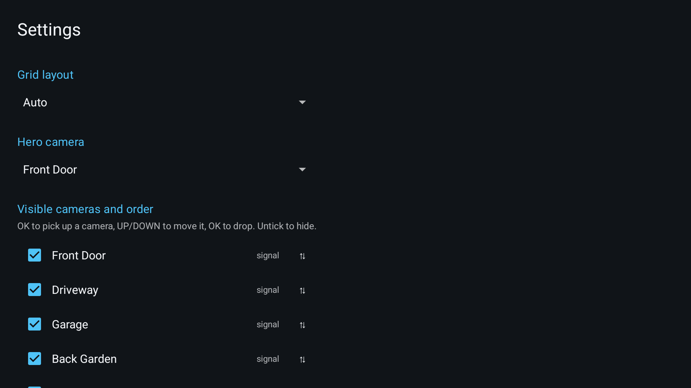
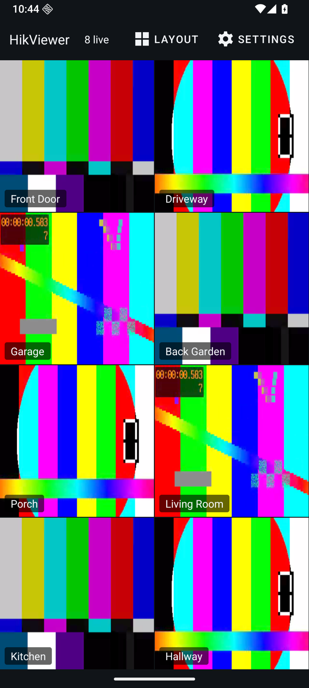
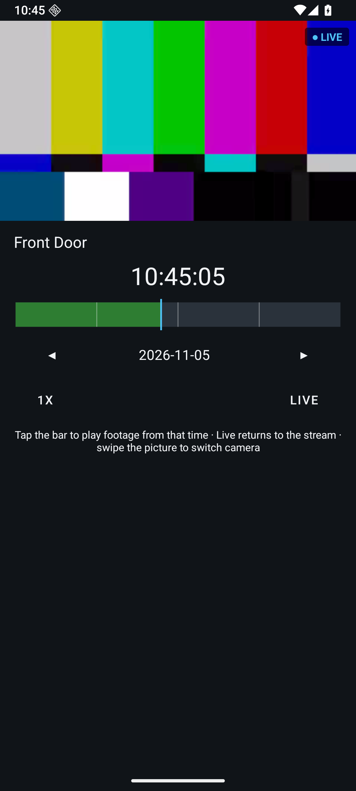

# HikViewer

**HikViewer** is a small, open-source Android TV and phone client for **Hik-Connect** accounts. Sign
in, pick the channels of your Hikvision DVR or NVR, and watch them live in a grid built for a remote
control, a mouse or a finger. Encrypted cloud streams are decrypted on the device with your own video
verification code. No alarms, no notifications, no accounts of its own, and a 2 MB APK instead of the
270 MB official app.

[ [Get the APK from GitHub Releases](https://github.com/itsluminous/HikViewer/releases/latest) ]

## Screenshots

The footage in these screenshots is synthetic: the debug build has a demo mode that plays bundled
ffmpeg test patterns under placeholder camera names, so no real camera ever appears in the
repository. See [BUILDING.md](BUILDING.md#demo-mode-and-screenshots).

| Sign in | 4 × 3 grid with the top bar | 1 + 7 (hero) layout |
| :---: | :---: | :---: |
|  |  |  |

| Fullscreen | Recorded playback | Settings |
| :---: | :---: | :---: |
|  |  |  |

| Phone grid (portrait) | Phone camera: live on top, timeline below |
| :---: | :---: |
|  |  |

## Features

- **Hik-Connect sign-in** with the official app's protocol: mobile number (the region adds the
  country code; a leading `+` or an e-mail address is sent as typed), password and region. CAPTCHA
  and SMS challenges are reported with a clear message instead of a spinner. Sessions refresh
  themselves; Logout clears everything.
- **Channel list** from your recorders. Channels with a video signal are shown by default; Settings
  lets you choose which cameras appear and in which order.
- **Grid layouts**: Auto, 3 × 3, 4 × 3, 4 × 4 and the "1 + N" family (1 + 5, 1 + 7, 1 + 9, 1 + 11,
  1 + 15: one large hero tile with N small ones to its right and below). The menu only offers
  layouts every tile of which would show a camera. Tile positions are remembered per layout and the
  last layout is restored on launch.
- **Move tiles**: long-press a tile (hold OK, long click or long touch) → *Move*, then push it with
  the D-pad, drag it with the mouse or your finger; OK drops it, Back cancels. In a 1 + N layout the
  first position is the hero.
- **Fullscreen**: OK on a tile. LEFT / RIGHT (or a swipe on a phone) switches camera, Back returns to
  the same tile. The hint hides after 5 s.
- **Recorded playback** from the long-press menu: fullscreen video, a 24 h time bar with the recorded
  spans highlighted, LEFT / RIGHT seek (hold to accelerate), a speed toggle (−10× … +10×; speeds other
  than 1× step between keyframes, reverse included, because the cloud only plays forward at 1×), and
  a date chip. Times are the recorder's own clock.
- **Hidden top bar on TV**: any key shows it, it hides 5 s after the last key, and it never steals
  focus. UP from the top row of tiles reaches its layout and settings buttons. On a phone the bar is
  always on screen (top in portrait, left edge in landscape) because there is no D-pad to summon it.
- **Phone camera screen**: tapping a tile in portrait does not rotate the phone. Live video fills
  the top (16:9) and the bottom half holds the same playback engine as the TV screen: scrub the time
  bar to go back into the recordings, change speed, change date.
- **Encrypted streams**: the first time a stream needs the key you are asked for the recorder's video
  verification code. It is checked locally against the recorder's `MD5(MD5(code))` before any stream
  is opened, stored in Android-encrypted preferences, and never asked again unless the recorder's
  code changes.
- **Built for weak TVs**: hardware decoders for the two tiles you are looking at (focused or hero),
  software decoders for the rest, and a shared keyframe-only decoder pool for tiles beyond what the
  device can decode live. The live budget adapts to RAM, cores and measured decode lag, and tiles
  are promoted back when headroom returns. A failed tile dims and shows a single *Retry* button.
- **Clean lifecycle**: every stream, socket and decoder is released in `onStop`; there are no
  services, jobs or alarms, so the app costs nothing when it is not on screen.
- **Settings**: layout, visible cameras and their order, hero camera, fullscreen stream quality
  (sub-stream by default), *Show camera names*, *Show frame rate*, *Change encryption password*,
  Logout.
- **One universal APK** for every architecture (there is no native code), with phone/tablet
  (touch) and Android TV (D-pad, mouse) launchers in the same build.

## How it works

1. **Sign in** against `api.hik-connect.com` (`/v3/users/login/v2`), following the regional
   redirect the cloud answers with; the password travels as an MD5 hash like in the official app.
2. **List devices and channels** (`/v3/userdevices/v1/devices/pagelist`, `cameras/info`); the
   device record also says whether streams are encrypted and carries the hash the verification code
   is checked against.
3. **Open a stream**: fetch the VTM relay assignment for the channel, sign a VTDU token with the
   session, and connect over plain TCP to the relay (`ysproto://` framing). Live streams come as
   RTP or MPEG-PS; recordings as MPEG-PS from `/v3/streaming/records` spans.
4. **Decrypt on the device**: each H.264/H.265 NAL body is AES-ECB encrypted with your verification
   code as the key; the three key variants seen in the wild are detected from the parameter sets.
5. **Decode with `MediaCodec`**, feeding access units straight to the codec. At most two hardware
   decoders are used (the focused and hero tiles); the rest are software, or keyframe-only stills
   from a shared pool when the device runs out of CPU.

All protocol code lives in the pure-JVM `:core` module and is covered by known-answer tests built
from real captures; `:app` is the Android UI and decoder plumbing.

## Install

Download `HikViewer-<version>-universal.apk` from the
[Releases](https://github.com/itsluminous/HikViewer/releases) page. It is one APK for every CPU.

- **Android TV**: sideload it. Either `adb connect <tv-ip>` then
  `adb install -r HikViewer-<version>-universal.apk`, or copy the APK to a USB stick and open it with
  a file manager on the TV. HikViewer appears on the TV home screen with its own banner.
- **Phone or tablet**: open the APK from your downloads (allow installs from that source once), or
  `adb install -r` it. The same APK handles touch, portrait and landscape.
- Android 8.0 (API 26) or newer. Verify a download with the `SHA256SUMS` file attached to the
  release, or with `apksigner verify --print-certs <apk>`.

## Usage tips

- **Many live tiles on a small TV**: the DVR decides the sub-stream's resolution and frame rate, not
  the app. For 12 or more live tiles set the sub-stream to **640 × 360 at 6–8 fps** on the recorder
  (*Record → Parameters → Sub-stream*); software decoding costs about a fifth of a core per
  960 × 480 @ 12 fps tile, so halving the pixels and the frame rate is what lets a 1 GB TV keep every
  tile live instead of falling back to keyframe stills.
- **Region sets the country code**: pick your region on the sign-in screen and type the mobile number
  without the country code (India → 91 is added for you). Type a leading `+` to send exactly what you
  typed, or your e-mail address if the account uses one.
- **Hero camera**: in a 1 + N layout long-press a tile → *Move* and push it to the top-left, or
  pick it under *Settings → Hero camera*.
- **Fullscreen quality**: *Settings → Fullscreen quality* can select the main stream (often HEVC
  720p+); that needs a hardware decoder, so leave it on *Sub* if fullscreen stutters.
- Memory: on a 1080p Android TV the app sits around 100 MB PSS with 12 live tiles and drops to a
  cached process holding no decoders or sockets within seconds of HOME or Back.

## Building

See [BUILDING.md](BUILDING.md) for prerequisites, build, tests, lint and coverage, the emulators,
the demo mode used for the screenshots, the real-account integration test and release signing.

## Contributing

Issues and pull requests are welcome. Keep `./gradlew check` green (ktlint, detekt, Android Lint
with warnings as errors, unit tests with coverage floors), add a test with every behaviour change,
and never commit real credentials, serials or camera footage: `local.env`, `.screenshots/` and
`.research/` are gitignored for that reason. Commit messages follow Conventional Commits.

## References

HikViewer stands on the shoulders of the open-source projects that documented the Hik-Connect / EZVIZ
protocols before it. They are credited, with what each one taught us, in
[REFERENCES.md](REFERENCES.md). Release notes live in [CHANGELOG.md](CHANGELOG.md); known gaps and
ideas in [docs/FOLLOW-UPS.md](docs/FOLLOW-UPS.md).

## Disclaimer

HikViewer is an unofficial client. It is not affiliated with, endorsed by or supported by Hikvision,
EZVIZ or Hik-Connect. It speaks a private, undocumented protocol that may change or be restricted at
any time, and it only works with cameras you own and an account you control. Use it at your own risk.

## License

[MIT](LICENSE) © 2026 itsluminous
